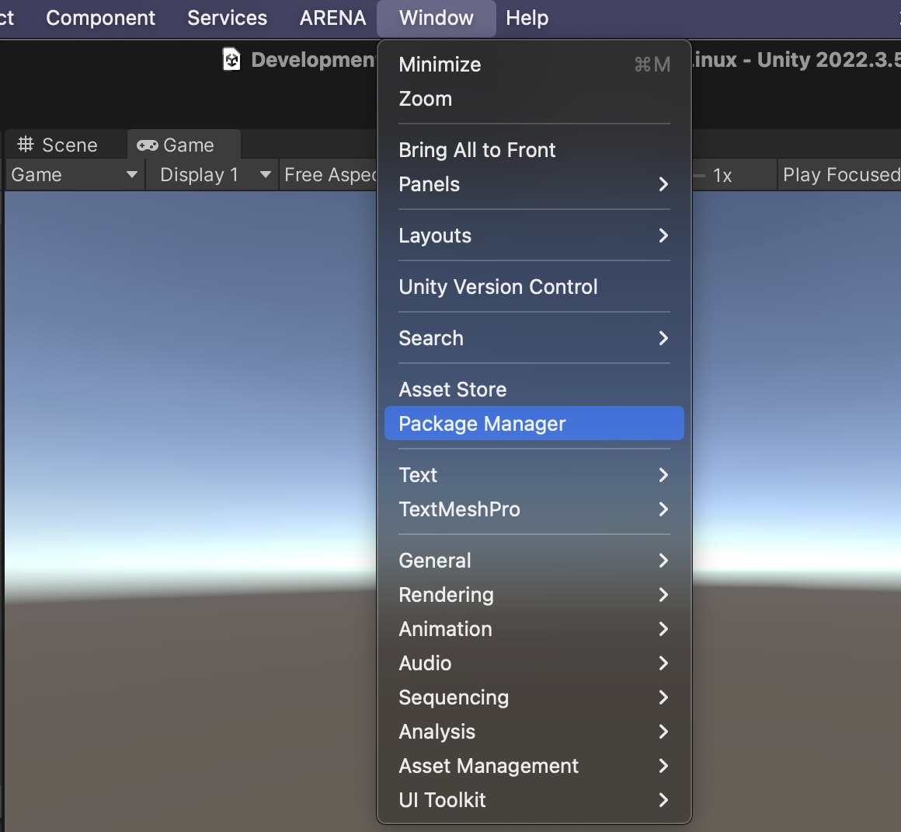
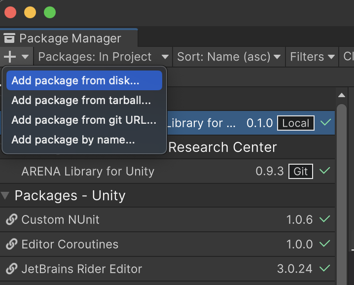
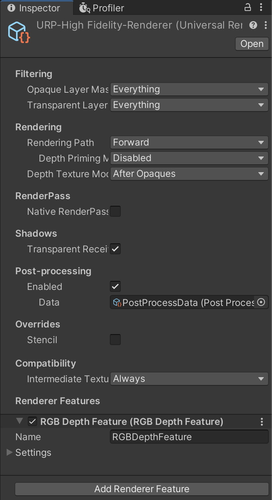
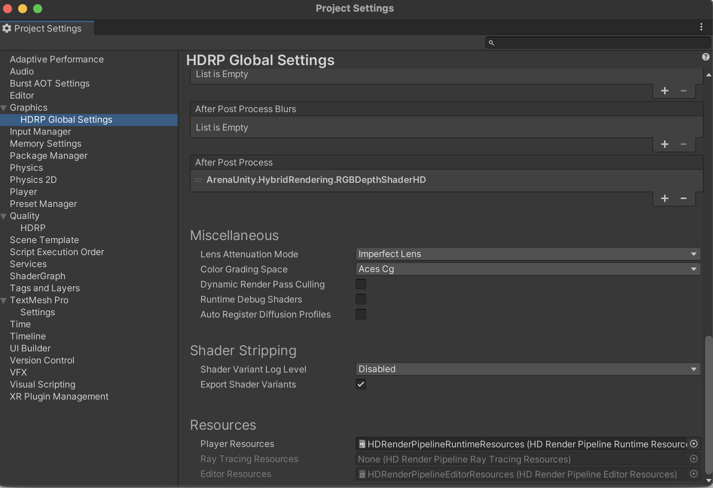

# Installation

Use Unity 6.3 LTS. For AR/VR clients, URP or HDRP is recommended for the best performance.

Enable **Run In Background** in Player Settings on the renderer application so streaming and heartbeat cleanup continue while the browser has focus. This is enabled in the included sample projects.

First, install the [ARENA-unity](https://github.com/arenaxr/arena-unity) package, following the instructions [here](https://docs.arenaxr.org/content/unity/).

The samples pin ARENA's Git revision in each project's `Packages/manifest.json`. RenderFusion's package manifests declare ARENA version `1.7.1`; Unity supports [Git dependencies only in project manifests](https://docs.unity3d.com/6000.3/Documentation/Manual/upm-git.html), so install ARENA first when setting up your own project.

To install the RenderFusion Unity package, select `Window/Package Manager` from the menu bar.



Then, select `+` and `Add package from git URL...`.



Input the string below to the input field.
```
https://github.com/arenaxr/arena-renderfusion.git?path=/Packages/RenderFusion
```

Existing projects that use the repository-root Git URL must change their core dependency to this URL. The package identity and existing script/prefab GUIDs are preserved.

## Prefabs

You should include the Prefab from `ARENA RenderFusion for Unity/Runtime/Prefabs` in your scene.

## URP

The Universal addon is in `Addons~/Universal`. Existing projects should update their package Git URL to this path; the package identity, assembly names, script GUIDs, and prefab GUIDs are preserved.

If you are working in URP, __also__ install
```
https://github.com/arenaxr/arena-renderfusion.git?path=/Addons~/Universal
```
IMPORTANT: Your URP Settings should include the `RGB Depth Feature` post processing effect that comes with this library.



## HDRP

The High Definition addon is in `Addons~/HighDefinition`. Existing projects should update their package Git URL to this path; the package identity, assembly names, script GUIDs, and prefab GUIDs are preserved.

If you are working in HDRP, __also__ install
```
https://github.com/arenaxr/arena-renderfusion.git?path=/Addons~/HighDefinition
```
IMPORTANT: Your HDRP Global Settings should include the `ArenaUnity.RenderFusion.RGBDepthHDRP` in the `After Post Process` item under the `Custom Post Process Order` list. You should see a split color/depth screen in the Editor if this is done correctly.


